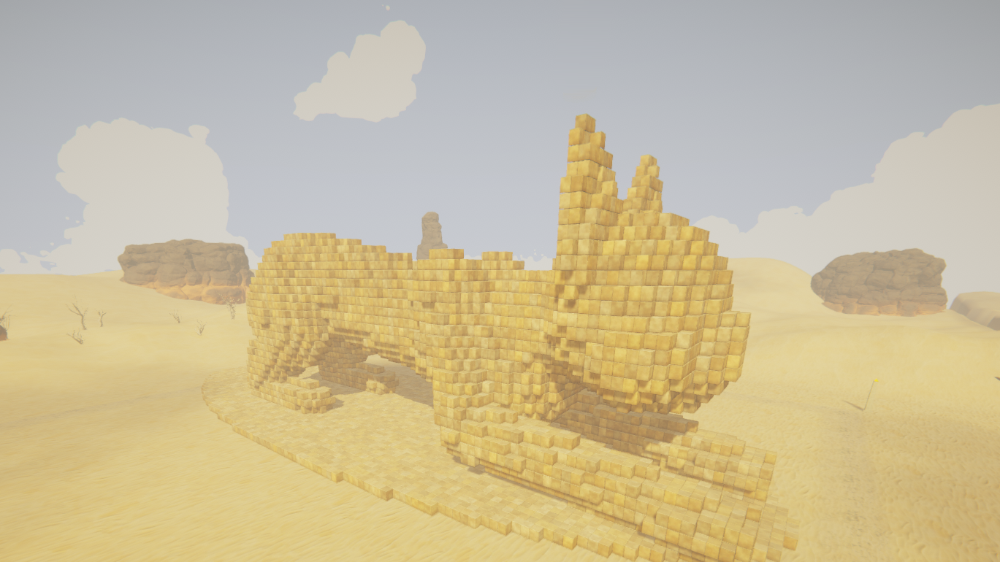
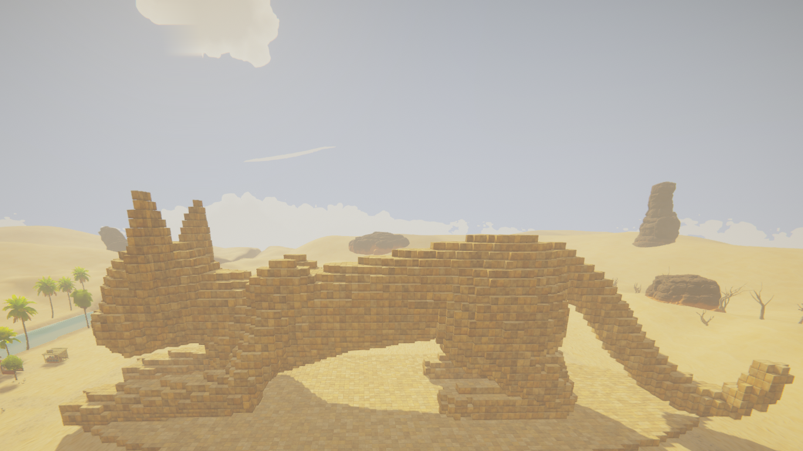
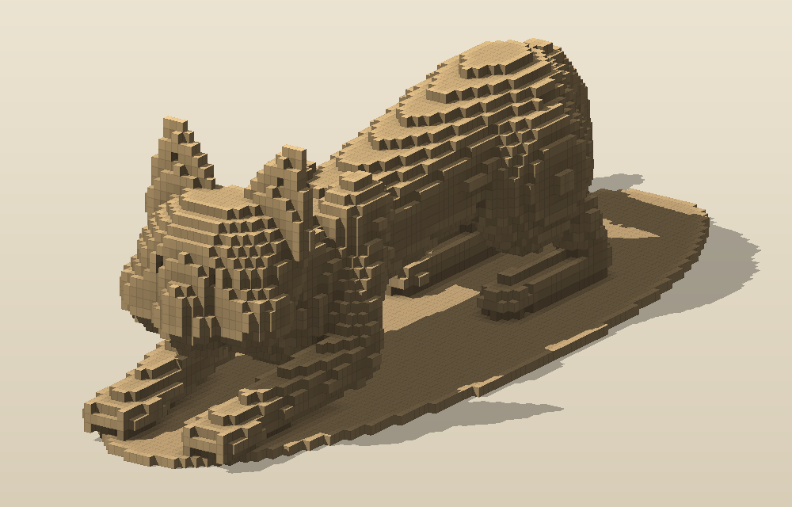
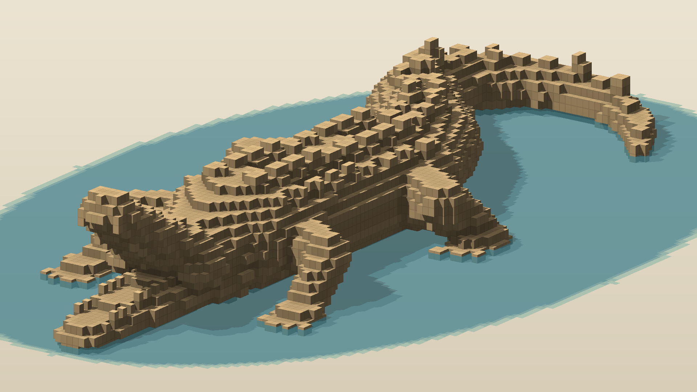
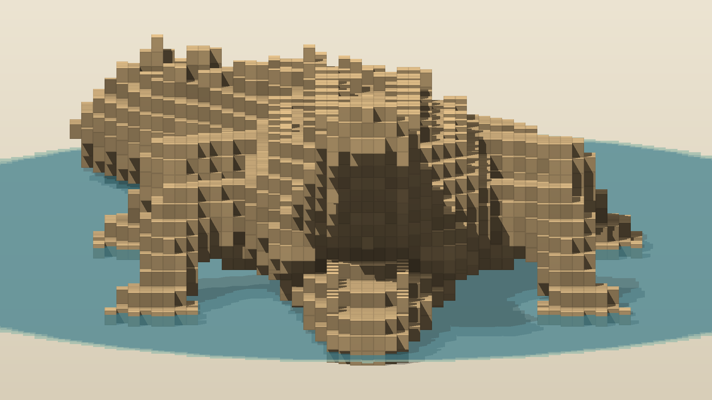

# Pyramids Custom Maps

An unofficial BepInEx mod for **How They Built the Pyramids** (game version 0.43.0) that adds custom maps. Instead of the usual pyramid, you build a giant statue, a famous monument or a strange pyramid, brick by brick, and building it is the whole objective, ending included. Every block is open from the start, so you build in any order. You can also make your own maps in MagicaVoxel.

**Statues** (blocks half the size of a pyramid block, so the curves come out smooth):

| Map | What it is | Size |
|---|---|---|
| **Great Cat** | A stone cat crouched to pounce | 24,052 blocks, 37.5 m tall |
| **Sobek** | A crocodile lying in an oval pool, jaws open to the sky | 19,538 blocks, 21 m tall, about 130 m long |
| **Anubis** (new in 0.5.0) | A jackal keeping watch from his shrine, ears high | 11,588 blocks |
| **Horus** (new) | A falcon with outstretched wings, wearing the double crown | 47,679 blocks, 100 m tall |

**Pyramids and monuments** (new in 0.5.0):

| Map | What it is | Size |
|---|---|---|
| **Upside-Down** | The classic pyramid's blocks, balanced on its tip; crown the plaza 65 m up | 23,427 blocks |
| **Upside-Down Grand** | The Grand Pyramid, upside down; a 170 m plaza 107 m in the air | 105,996 blocks |
| **Diamond** | An upside-down pyramid with a pyramid on its plaza, 127 m tall | 44,251 blocks |
| **Step Pyramid** | Djoser's six tiers, 60 m on a 122 m base | 38,921 blocks |
| **Bent Pyramid** | Steep below, gentler above | 38,235 blocks |
| **Nubian Field** | A dozen steep Nubian pyramids, like those at Meroe | 7,684 blocks |
| **Ziggurat** | Three terraces, a grand stairway and a shrine, 45 m high | 11,943 blocks |
| **Giza** | Khufu, Khafre and Menkaure, and the Great Sphinx | 63,213 blocks |
| **Colossi** | The Colossi of Memnon, two seated pharaohs 38 m tall | 10,776 blocks |
| **Sphinx Avenue** | Twelve sphinxes lining a road to a 37 m obelisk | 4,346 blocks |
| **Colossal Pyramid** | The pyramid at about 4.5 times the Grand Pyramid, 178 m tall | 477,191 blocks |

**Download:** [Nexus Mods](https://www.nexusmods.com/howtheybuiltthepyramids/mods/3) or this repo's [Releases](https://github.com/kaesoclarus/pyramids-custom-maps/releases).


| | |
|---|---|
|  |  |
|  |  |



| | |
|---|---|
|  |  |
|  |  |

## Playing

1. Install [BepInEx 5.4.23.6 for Windows x64](https://github.com/BepInEx/BepInEx/releases) into the game folder.
2. Download the latest zip from [Nexus Mods](https://www.nexusmods.com/howtheybuiltthepyramids/mods/3) or this repo's **Releases** page, and extract it into the game folder.
3. On the main menu, scroll to the empty plot, pick a map from the **Custom map** dropdown next to Pyramid and Grand Pyramid, and start a new world.

Everyone who plays together needs the mod, at the same version. See [`release/README.txt`](release/README.txt) for the full player guide.

### How building a statue works

- **Any order:** every block is open from the start, not one layer at a time.
- **No floating bricks:** a block must touch a laid block, or sit on the ground layer. Overhangs grow out from their neighbours.
- **Reach:** you can place a block one layer (1.25 m) above your feet.
- **Markers:** small markers show where you can build next. **F7** turns them on and off.
- **Shabti:** they build from a Work Post on the statue next to a brick crate, or from one on the ground beside its base.
- **No pyramid aids:** stone ramps, scaffold platforms and the sledge lift are disabled on custom maps, except the Colossal Pyramid, which is the game's own pyramid made bigger.
- **Endings:** the highest block is the last brick: the cat's left ear, Sobek's snout, Horus's crown, Khufu's tip at Giza, the obelisk on Sphinx Avenue.
- **Sobek's pool:** an oval pool, 0.6 m deep, dug around the build site. You can wade through it, and machines can stand in the shallows.
- **Colossal Pyramid:** its site is moved south onto a cleared plain, and the play area is opened up around it.
- **Big maps:** the first time you pick Horus or Upside-Down Grand on the menu in a session, the game may pause for a few seconds while it works out the shape.
- **Rankings:** statue worlds stay off the game's online world rankings.

## Building from source

You need:

- **The game**, installed through Steam, with BepInEx 5.4.23.6 in its folder.
- **The [.NET 8 SDK](https://dotnet.microsoft.com/download/dotnet/8.0).**

```powershell
dotnet build src/PyramidsMaps -c Release
```

The build references the game's own DLLs from its install folder and copies the plugin into `BepInEx\plugins\PyramidsMaps`.

**Different install folder?** If the game isn't at the default Steam path, pass it in:

```powershell
dotnet build src/PyramidsMaps -c Release -p:GamePath="D:\SteamLibrary\steamapps\common\How They Built the Pyramids"
```

**Build without installing:** add `-p:Deploy=false`.

## Project layout

| Path | What it is |
|---|---|
| `src/PyramidsMaps` | The BepInEx plugin |
| `src/PyramidsMaps/Shapes` | The statues, modelled as smooth solids and sampled into blocks; reachability checks |
| `src/PyramidsMaps/Statues` | Statue worlds (any map): layout, any-order building, rendering, Shabti, footprint, diagnostics, photo mode |
| `src/PyramidsMaps/Maps` | Map selection: the list of maps (`MapRegistry`), the menu dropdown, player maps, per-world markers, world-kind sync for multiplayer |
| `tools/ShapePreview` | Renders previews of the shape (ray-traced PNGs) and checks every block can be built by hand |
| `tools/Decomp` | Decompiles the game's assembly locally, for reading its code (the output is not part of this repo) |
| `PLAN.md` | Design notes and history |

## Making your own map (no coding)

Build a model in [MagicaVoxel](https://ephtracy.github.io/) and save it as a `.vox` file in `BepInEx\plugins\PyramidsMaps\maps`. After a restart it appears in the main menu's **Custom map** dropdown. That folder's `README.txt` (written on first run) has the details:

- **Blocks:** each voxel is one block, 1 × 1 × 1.25 m, or the game's 2 × 2 × 2.5 m pyramid block with `blocks=pyramid` in an optional `<name>.txt` next to it. The same file can set a `title` and `description`.
- **Orientation:** MagicaVoxel's front faces the river. The model is centred on the build site, standing on the ground.
- **Build check:** when the game starts, the mod checks that every block can be built by hand and logs any that can't to `BepInEx\LogOutput.log`.
- **Sharing:** everyone in a multiplayer game needs the same file. Worlds remember the exact file they started with.

To preview a model, or to start from one of the built-in shapes:

```powershell
dotnet run --project tools/ShapePreview -c Release -- --shape my_map.vox preview.html
dotnet run --project tools/ShapePreview -c Release -- --shape giza --write-vox giza.vox preview.html
```

## Adding a built-in map

1. Model its shape in `src/PyramidsMaps/Shapes` (see `SobekShape.cs` for a statue, `PyramidVariants.cs` for block-by-block shapes), and preview it with `tools/ShapePreview --shape <name>`.
2. Add one entry to `src/PyramidsMaps/Maps/MapRegistry.cs` with an unused sync code (0–31; player maps use 32–63). Give it a new code whenever its shape changes.

It then appears in the main menu's **Custom map** dropdown.

## Debug keys

| Key | What it does |
|---|---|
| **F8** | Writes a placement and Shabti report to `BepInEx\LogOutput.log` |
| **F9** twice | Host only, with `DevTools = true` in the config: fills every block except the final one. Use it in throwaway worlds only. |
| **F11** | Free camera for screenshots: arrow keys move, PageUp/PageDown up and down, Shift faster, mouse looks. Hides the HUD, the first-person hands and the build beacons. |
| **F10** | Saves a clean screenshot (no HUD) to `BepInEx\plugins\PyramidsMaps\screenshots` |

The game's own F1 dev panel needs the `-devpanel` launch option.

## Notes

- This is an unofficial fan mod, not made or supported by PattezGames.
- None of the game's code or assets are included in this repository.
- Game updates may break the mod. It checks the game version and warns in the log.
