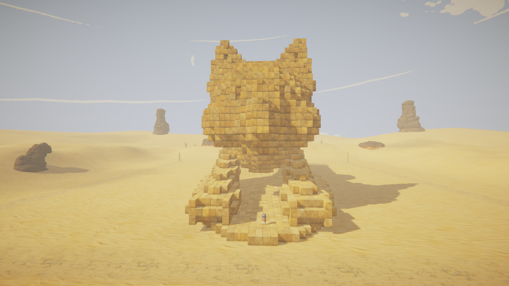
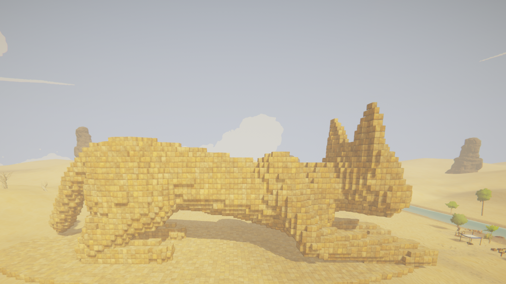
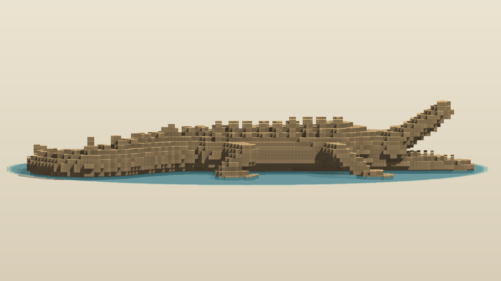
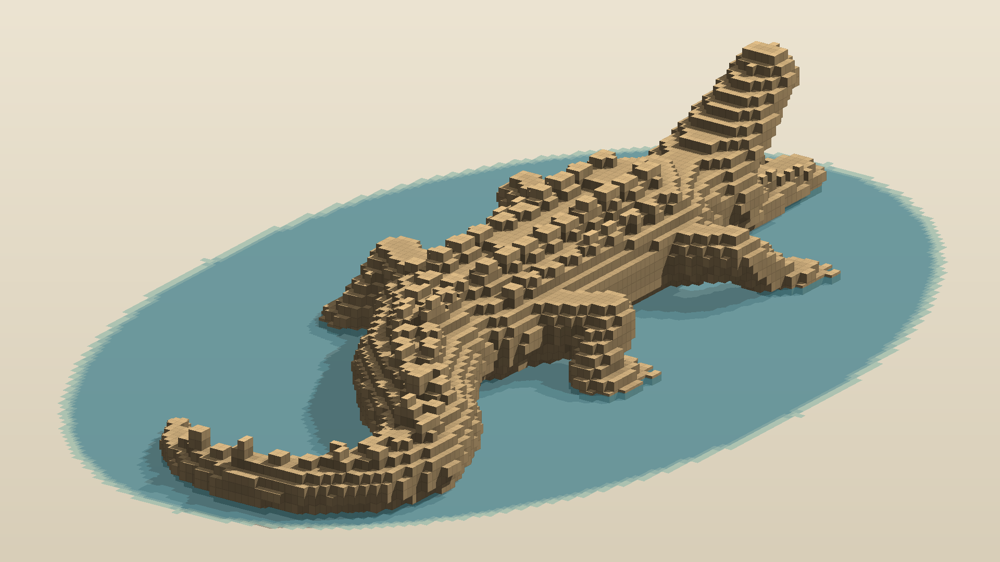
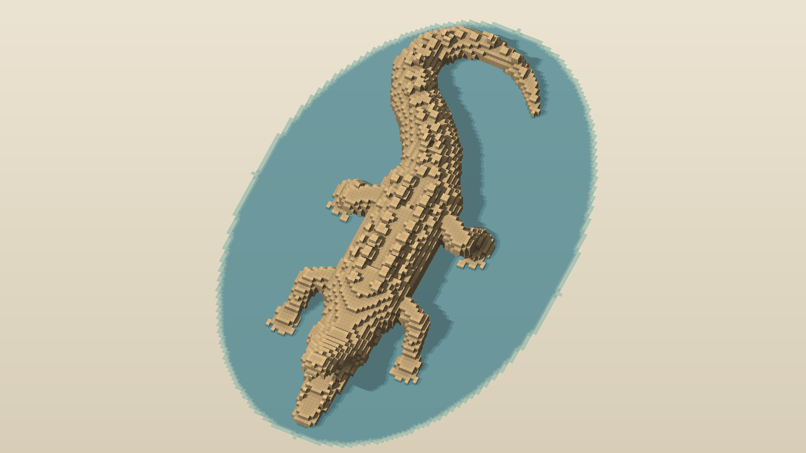

# Pyramids Custom Maps

An unofficial BepInEx mod for **How They Built the Pyramids** (game version 0.43.0) that adds custom maps. Instead of a pyramid, you build a giant statue brick by brick, and building it is the whole objective, ending included. Statue blocks are half the size of a pyramid block, so the curves come out smooth.

| Map | What it is | Size |
|---|---|---|
| **The Great Cat** | A stone cat crouched to pounce | 24,052 blocks, 37.5 m tall |
| **Sobek** (new in 0.4.0) | A crocodile lying in an oval pool, jaws open to the sky | 19,538 blocks, 21 m tall, about 130 m long |

**Download:** [Nexus Mods](https://www.nexusmods.com/howtheybuiltthepyramids/mods/3) or this repo's [Releases](https://github.com/kaesoclarus/pyramids-custom-maps/releases).



| | |
|---|---|
|  |  |
|  |  |


| | |
|---|---|
|  |  |
|  |  |

## Playing

1. Install [BepInEx 5.4.23.6 for Windows x64](https://github.com/BepInEx/BepInEx/releases) into the game folder.
2. Download the latest zip from [Nexus Mods](https://www.nexusmods.com/howtheybuiltthepyramids/mods/3) or this repo's **Releases** page, and extract it into the game folder.
3. On the main menu, scroll to the empty plot, pick **Great Cat** or **Sobek**, and start a new world.

Everyone who plays together needs the mod, at the same version. See [`release/README.txt`](release/README.txt) for the full player guide.

### How building a statue works

- **Any order:** every block is open from the start, not one layer at a time.
- **No floating bricks:** a block must touch a laid block, or sit on the ground layer. Overhangs grow out from their neighbours.
- **Reach:** you can place a block one layer (1.25 m) above your feet.
- **Markers:** small markers show where you can build next. **F7** turns them on and off.
- **Shabti:** they build from a Work Post on the statue next to a brick crate, or from one on the ground beside its base.
- **No pyramid aids:** stone ramps, scaffold platforms and the sledge lift are disabled in statue worlds.
- **Endings:** the cat's last brick is the tip of her left ear; Sobek's is the tip of his raised snout.
- **Sobek's pool:** an oval pool, 0.6 m deep, dug around the build site. You can wade through it, and machines can stand in the shallows.
- **Rankings:** statue worlds stay off the game's online world rankings.

## Building from source

You need:

- **The game**, installed through Steam, with BepInEx 5.4.23.6 in its folder.
- **The [.NET 8 SDK](https://dotnet.microsoft.com/download/dotnet/8.0).**

```powershell
dotnet build src/PyramidsMaps -c Release
```

The build references the game's own DLLs from its install folder and copies the plugin into `BepInEx\plugins\PyramidsMaps`.

**Different install folder?** If the game isn't at the default Steam path, pass it in:

```powershell
dotnet build src/PyramidsMaps -c Release -p:GamePath="D:\SteamLibrary\steamapps\common\How They Built the Pyramids"
```

**Build without installing:** add `-p:Deploy=false`.

## Project layout

| Path | What it is |
|---|---|
| `src/PyramidsMaps` | The BepInEx plugin |
| `src/PyramidsMaps/Shapes` | The statues, modelled as smooth solids and sampled into blocks; reachability checks |
| `src/PyramidsMaps/Statues` | Statue worlds (any map): layout, any-order building, rendering, Shabti, footprint, diagnostics, photo mode |
| `src/PyramidsMaps/Maps` | Map selection: menu buttons (`MapRegistry`), per-world markers, world-kind sync for multiplayer |
| `tools/ShapePreview` | Renders previews of the shape (ray-traced PNGs) and checks every block can be built by hand |
| `tools/Decomp` | Decompiles the game's assembly locally, for reading its code (the output is not part of this repo) |
| `PLAN.md` | Design notes and history |

## Adding a map

1. Model its statue in `src/PyramidsMaps/Shapes` (see `SobekShape.cs`), and preview it with `tools/ShapePreview --shape <name>`.
2. Add one entry to `src/PyramidsMaps/Maps/MapRegistry.cs`, with a new sync index.

It then gets a button on the main menu's empty plot.

## Debug keys

| Key | What it does |
|---|---|
| **F8** | Writes a placement and Shabti report to `BepInEx\LogOutput.log` |
| **F9** twice | Host only, with `DevTools = true` in the config: fills every block except the final one. Use it in throwaway worlds only. |
| **F11** | Free camera for screenshots: arrow keys move, PageUp/PageDown up and down, Shift faster, mouse looks. Hides the HUD, the first-person hands and the build beacons. |
| **F10** | Saves a clean screenshot (no HUD) to `BepInEx\plugins\PyramidsMaps\screenshots` |

The game's own F1 dev panel needs the `-devpanel` launch option.

## Notes

- This is an unofficial fan mod, not made or supported by PattezGames.
- None of the game's code or assets are included in this repository.
- Game updates may break the mod. It checks the game version and warns in the log.
